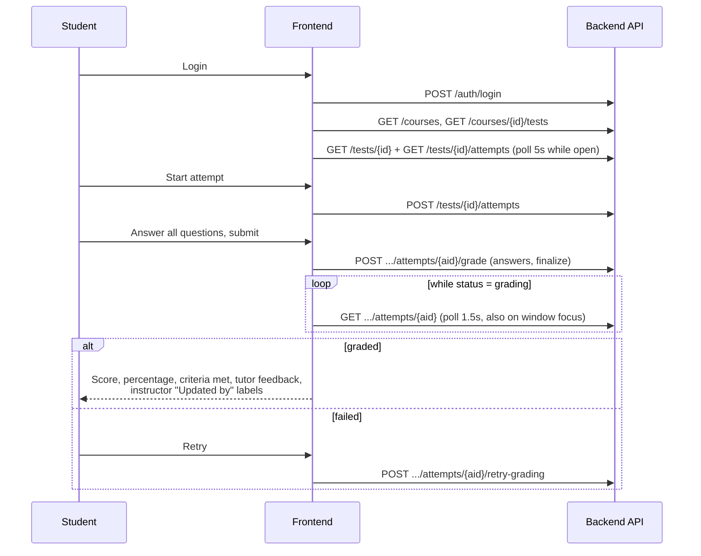
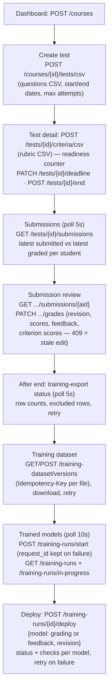

# Frontend

Next.js (App Router) web app for the LLM-assisted assessment system. Students
take rubric-based tests and watch their answers get graded in real time;
instructors author courses and tests, review and correct submissions, manage
the versioned training dataset, and train/deploy retrained grading and
feedback models. The browser calls the [backend](../backend) directly at
`NEXT_PUBLIC_API_URL` — there are no server-side route handlers in this repo,
and all backend work (durable grading, dataset publication, model
deployment) happens in the backend's PostgreSQL-backed workers.

## Run locally

```bash
docker compose up --build -d     # open http://localhost:3000
```

The container serves the frontend only; keep the backend running locally at
`http://localhost:8002`. `FRONTEND_PORT` changes the host port if 3000 is
taken (bind IP via `FRONTEND_BIND_IP`).

Compose reads an optional local `.env` for `NEXT_PUBLIC_API_URL`,
`NEXT_PUBLIC_GRADING_API_KEY`, and `FRONTEND_PORT`. `NEXT_PUBLIC_*` values
are baked into the browser bundle **at image build time** — rebuild with
`docker compose up --build -d` after changing them, and keep them
browser-safe (they are visible to users). `.env` is excluded from the Docker
build context.

```bash
docker compose logs -f frontend
docker compose down
```

For development without Docker: `npm install && npm run dev`.

## App structure

| Area | Routes |
|---|---|
| Shared | `/` (role redirect), `/login`, `/register` |
| Student | `/student`, `/student/courses/{courseId}`, `.../tests/{testId}`, `.../attempts/{attemptId}` |
| Instructor | `/instructor` (dashboard), `/instructor/courses/{courseId}`, `.../exams/new`, `.../tests/{testId}`, `.../submissions`, `.../submissions/{attemptId}`, `/instructor/training-dataset`, `/instructor/training-models` |

**Sessions.** Login stores the JWT and the user profile in `localStorage`
(`auth_token`, `auth_user`); every API request sends `Authorization: Bearer
<token>`, and `X-API-Key` when `NEXT_PUBLIC_GRADING_API_KEY` is set.
Registration supports students (public) and staff (sends the optional
`X-Staff-Registration-Key` header). Route protection is client-side: the
`/student` and `/instructor` layouts render nothing until the session's role
matches, and the landing page redirects by role.

**Live status.** Pages poll the backend while state can change: test
availability every 5 s (plus one-shot timers at `starts_at`/`ends_at`),
grading progress every 1.5 s, submissions and training-export status every
5 s, dataset versions every 3 s, storage status every 10 s, and training
runs every 10 s. Manual reload buttons only change how the next poll result
is announced (toast).

## Student flow



Students can leave the test page after submitting and return to the same
stable result URL; attempt history is listed on the test page, and an
unfinished `in_progress` attempt can be continued.

## Instructor flow



Notable mechanics:

- **Grade editing** sends only changed responses with the attempt's
  `revision`; a 409 conflict disables the form (stale-edit protection). For
  rubric questions the total is the sum of the per-criterion scores, and
  criterion scores must all be provided together. Only the student's latest
  graded submission can be edited.
- **Dataset uploads** generate one `Idempotency-Key` per selected file,
  reused on retry; version history offers per-version downloads and retry of
  failed publications.
- **Trained models** shows candidate cards with grading metrics against the
  base-model baseline, an in-progress banner (manual vs nightly runs), and
  independent deploy buttons for the grading and feedback adapters. With no
  registered runs the page shows a static preview and disables deployment.

## Features implemented

### Accounts and navigation
**Login, registration, logout.** Students and instructors log in on `/login`
(email + password); the JWT and profile are stored in `localStorage` and the
landing page `/` redirects by role (`/student` or `/instructor`).
`/register` creates student accounts publicly and staff accounts with the
bootstrap key; the header's logout clears the session.

### Student: find, take, and review a test
**Course and test browsing, attempt history, start/continue, submission, live
grading, results, retry.**

1. `/student` — list of courses; click one to open its tests.
2. `/student/courses/{courseId}` — the course's tests with their start/end
   times and attempt limits.
3. `/student/courses/{courseId}/tests/{testId}` — the test page: open/closed
   status, the "Your attempts" history (every attempt links to its result
   page), a "Continue attempt N" link when an attempt is unfinished
   (`in_progress`), and the **Start attempt** button (disabled while the
   test is closed or the attempt limit is reached).
4. `/student/courses/{courseId}/tests/{testId}/attempts/{attemptId}` — one
   page for both phases: answer each question in its text area and press
   **Submit for grading**, then the page switches to the live review view,
   polling every 1.5 s while `grading`. When graded it shows the score,
   percentage, per-criterion met/unmet detail, and tutor feedback
   (instructor corrections are marked "Updated by instructor"). If grading
   fails, **Retry grading saved answers** re-queues the job from the saved
   answers. The result URL is stable, so the student can leave and return.

### Instructor: build and run a test
**Course creation, CSV test creation, rubric CSV upload, deadlines, early
closure, submissions roster, training export monitoring.**

1. `/instructor` — dashboard: create a course (code + name), list existing
   courses, and links to **Trained models** and **Training dataset**.
2. `/instructor/courses/{courseId}` — the course's tests and **New test**.
3. `/instructor/courses/{courseId}/exams/new` — the test form: name, start
   and end dates (end must be after start), max attempts, and the questions
   CSV (`id, prompt, max_score, score_increment[, model_answer]`).
4. `/instructor/courses/{courseId}/tests/{testId}` — test detail: the
   **Grading readiness** panel (questions with rubrics, N of total, listing
   any that are missing), the **Rubric criteria** CSV upload, and the
   **Availability and deadline** section (extend `ends_at`, end the test
   early). After the test is ended, a **Training export** panel appears on
   this page: status, eligible row count, excluded rows with reasons, and a
   retry button.
5. `/instructor/courses/{courseId}/tests/{testId}/submissions` — roster of
   all registered students, each with their latest submitted attempt
   (status, date, attempt number) and latest graded attempt separately.

### Instructor: review and correct a submission
**Revision-checked overrides and per-criterion corrections.** From the
roster, **View latest submission** or **Edit latest graded attempt (N)**
opens `/instructor/courses/{courseId}/tests/{testId}/submissions/{attemptId}`:
per-question score, per-criterion scores, and feedback are editable. Saving
sends only the changed responses with the attempt's `revision`; a 409
conflict (stale edit) disables the form. Rubric questions require a score
for every criterion in one save, and only the latest graded attempt is
editable — the totals and percentages then reflect the overrides.

### Instructor: training dataset
**Versioned upload, history, downloads, retry.** On
`/instructor/training-dataset`: upload a rubric CSV (one idempotency key per
file, reused on retry), browse the version list with publication status,
active version, and the "course · test" export contributions, download the
active or any historical version, and retry failed publications. Storage
readiness is shown at the top of the page.

### Instructor: train and deploy models
**Train now, in-progress status, candidate metrics, per-model deploy.** On
`/instructor/training-models`: **Train now** starts a run (its request id is
kept if the start fails), an in-progress banner tracks manual and nightly
runs, and each registered candidate shows its grading metrics against the
baseline. Grading and feedback deploy independently per model — the
buttons deploy a candidate, retry a failed deployment, and show each
model's deployment status and compatibility checks. With no registered
runs the page shows a static preview and deployment is disabled.

### Shared UI
Toast notifications for every action result, breadcrumbs on all nested
pages, status badges (test and attempt state, publication and deployment
status), and manual reload buttons on live pages.

The backend (this repo's sibling [`backend`](../backend)) provides
authentication, catalog storage, durable grading, dataset publication, and
model deployment; [`deployment`](../deployment) hosts the serving stack and
the nightly retraining workflow.
